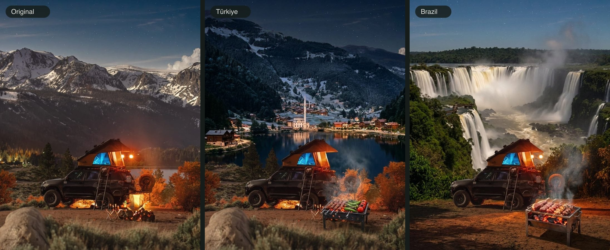
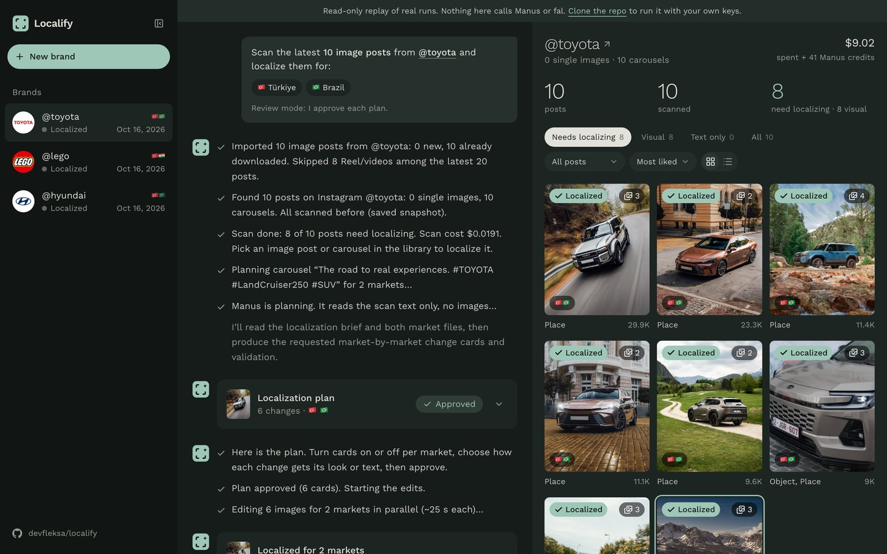
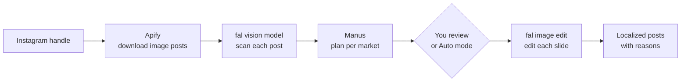

# Localify

Localify adapts a brand's Instagram image posts to other markets. It changes more than the caption. It replaces the places, objects, food, dates and the text inside the images so a post fits the culture of each market.

It works on a whole account, not one post at a time. Localify scans the brand's library and sorts every post by what it needs for each market: visual changes, only text changes, or nothing. A business can see at a glance which posts don't fit a market and regenerate all of them in one go. An AI agent decides what to change in each post and explains why, an image model makes the edits, and you can approve every plan yourself or let Auto mode work through the whole list.

We built it at the Slush'D "10X Your Brand" Hackathon in Istanbul on October 12, 2026, and kept working on it after the event.

**[Open the live replay](https://devfleksa.github.io/localify/)** to see three real runs (Toyota, LEGO and Hyundai). It is read only and needs no setup.



<sub>The same Toyota post for two markets. In the Türkiye version the lake becomes Uzungöl and the campfire becomes a mangal. In the Brazil version the background becomes Iguaçu Falls and the campfire becomes a churrasqueira. The car, the tent and the light are unchanged.</sub>

## Our story

We're [@devfleksa](https://github.com/devfleksa) and [@gokturkcolak](https://github.com/gokturkcolak). We didn't know each other before the hackathon. We ended up at the same table at breakfast, got talking, and by the time the opening talk started we were a team.

To be honest, the first couple of hours didn't go great. We kept talking about ideas and had nothing built. What we finally agreed on was something we'd both noticed: brands post the same content in every country, and it doesn't always land. Translating the caption isn't enough when the photo shows a place, a food or a sign that means nothing to people in that market. Someone on a marketing team usually fixes that by hand, post by post. We wanted to automate it, and not just for one post. The plan was to scan a brand's whole feed, figure out which posts actually need changes for which market, and redo all of them at once.

At first we wanted to do videos too. We tried the video models on fal and it didn't take long to see that wasn't going to work in one day. It was expensive, and getting good results would have needed a lot more tuning and much more complicated workflows. So we dropped video and put everything into image posts and carousels.

We built the web app, hooked up Manus as the planner, and pitched it in three minutes (two minutes of slides, one minute of live demo). We didn't make the top 6. We were a bit disappointed, but we had a really good day and learned a lot.

We liked the idea too much to leave it there, so after the hackathon we cleaned up the UI, fixed the things that broke on real accounts, and made it open source so anyone can run it with their own keys. It's far from perfect. The prompts and the way posts get classified could be a lot better, so if you feel like improving it, go for it.

## What it does



1. **Import.** You enter an Instagram handle. The app checks the account and downloads the latest image posts and carousels. Reels are skipped.
2. **Scan and sort.** A vision model reads every post and lists what is specific to a market: places, objects, food, text in the image, dates and prices. The library is then sorted into posts that need visual changes, posts that only need text changes and posts that are fine as they are, so you know where to start.
3. **Plan.** You pick a post. Manus reads the scan and the rules for each market and returns a list of changes per market, each with a reason. For example "campfire to mangal" for Türkiye.
4. **Review.** You can turn changes on or off, edit the new text and choose a reference image. In Auto mode the agent localizes every flagged post by itself, and you can stop and resume it.
5. **Edit.** fal edits each slide for each market and keeps the original aspect ratio. You can compare before and after, regenerate a slide and download one slide, one market or everything as a zip.

Supported markets are the United States, Türkiye, Japan, Saudi Arabia, India and Brazil. Text is rewritten in each market's language (Hindi for India), and the brand's tagline stays as it is.

## How it works



Manus never sees the images. It gets the scan as text, a planning prompt (`web/prompts/plan-post.md`), shared rules (`rules.md`) and one file per market (`web/prompts/markets/<code>.md`), and it answers in a fixed JSON format. That keeps each decision traceable to a rule.

To add a market, add one line to `web/lib/markets.ts` and write one Markdown file for it.

## Tech stack

We used Manus, fal and Apify because they were the hackathon's sponsors and every team received credits for them. There may be better or cheaper options for each step, and the code keeps them in separate files (`web/lib/engine/manus.ts`, `web/lib/fal.ts`, `web/lib/apify.ts`) so they can be swapped.

| Part | What we used |
|---|---|
| Web app | Next.js 15, React 19, TypeScript |
| Interface | Tailwind CSS 4, Radix UI, lucide icons, sonner, JSZip |
| Planning agent | Manus API v2 with structured output |
| Scan | fal, Gemini 2.5 Flash through `openrouter/router/vision` |
| Image edits | fal, `nano-banana-pro/edit` (and `nano-banana-pro` for reference images) |
| Instagram import | Apify `fast-instagram-post-scraper` |
| Storage | JSON files and images on disk in `web/data/` |
| Deployment | Node.js or Docker Compose; the replay is a static build on GitHub Pages |

## Run it yourself

You need Node.js 20 or newer and three API keys.

| Key | Used for | Get it at |
|---|---|---|
| `MANUS_API_KEY` | Planning the changes | [manus.im](https://manus.im), Settings, API |
| `FAL_KEY` | Scanning and editing images | [fal.ai/dashboard/keys](https://fal.ai/dashboard/keys) |
| `APIFY_TOKEN` | Importing Instagram posts | [console.apify.com](https://console.apify.com/account/integrations) |

```bash
git clone https://github.com/devfleksa/localify.git
cd localify/web
npm install
npm run setup    # asks for the keys, tests them and writes .env.local
npm run dev      # open http://localhost:3000
```

Run `npm run setup -- --check` to test the keys again. You can also copy `web/.env.example` to `web/.env.local` and fill it in by hand.

With Docker:

```bash
cd web && npm run setup && cd ..
docker compose up --build    # open http://localhost:3000
```

Use `PORT=3200 docker compose up` for another port. Your jobs, imported posts and results are saved in `web/data/`. There is no login when you run it on your own machine. Set `ACCESS_CODE` in `.env.local` if other people can reach it.

### Costs

| Step | Price |
|---|---|
| Import with Apify | about $0.001 per post read (Reels are read and then skipped) |
| Scan with fal | about $0.002 per post, only once per post |
| Plan with Manus | about 5 credits per post |
| Edit with fal | $0.15 per edited image |

The Toyota run in the replay imported 10 posts and localized 8 of them for two markets. It cost $9.02 and 41 Manus credits. The app shows the cost of every job as it runs.

### Commands

Run these in `web/`.

| Command | What it does |
|---|---|
| `npm run setup` | Sets and tests the API keys |
| `npm run check:prompts` | Checks the market files and prints the prompt sizes |
| `node scripts/export-run.mjs <jobId>` | Exports finished runs for the replay |
| `npm run build:showcase` | Builds the read only replay as a static site |

More developer notes are in [`web/README.md`](web/README.md).

## Limits and known issues

- Only Instagram and only image posts. Reels and video slides are skipped.
- The prompts still make mistakes, and the known cases are in [`docs/prompt-tuning.md`](docs/prompt-tuning.md). Street signs in the foreground can stay after a background swap. A close up photo can be zoomed out when its background is replaced. The brand's own product is sometimes flagged even though it can't be changed. Manus sometimes leaves out a text change. In the Hyundai replay we added the Arabic text on slide 5 by hand.
- The six market files were written from general knowledge. The places and rules need a check by people from those markets, and the Hindi and Arabic text needs a native speaker.
- It is built for one person on one server. Jobs are kept in memory and in JSON files.

## Thanks

Thanks to Istanbul Ignited by Slush'D for organizing the event, and to Manus, fal and Apify for the credits. The interface was designed with [tasteskill](https://www.tasteskill.dev/) by Leon Lin and blueemi. A copy of the skill is in `.claude/skills/design-taste-frontend/` under its MIT license, with the direction it chose for Localify in `.taste-skill/direction.json`.

## License and disclaimer

The code is released under the [MIT License](LICENSE).

The replay shows a few public Instagram posts by Toyota, LEGO and Hyundai as examples. The images belong to their owners. This project is not affiliated with or endorsed by these brands or by Instagram. Every post links to the original. If you own one of these posts and want it removed, please open an issue.
